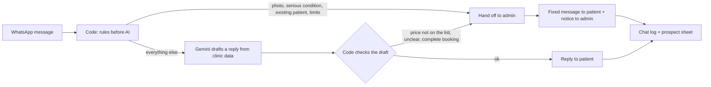

# ChatKlinik: AI WhatsApp Assistant for Beauty Clinics (n8n)

Answers patient WhatsApp messages for a beauty clinic from the clinic's own price list, schedule and promos. The AI drafts the reply, and code checks it before it is sent: a price that isn't on the clinic's list never reaches the patient, skin photos and serious skin conditions go straight to the clinic team, and the assistant tells the truth about when a human will reply. Booking requests are recorded in a Google Sheet, and requests that wait more than 24 hours are flagged.

> **Demo clinic.** The bot runs for a fictional clinic, *Klinik Aura Derma*, with made-up prices, doctors and promos. Patient names and numbers shown on the landing page are fictional. The assistant, its messages and the node names are in Indonesian, because it is built for clinics in Indonesia.

Landing page with a chat simulation and a link to the live demo bot: [chatklinik.com](https://chatklinik.com) (in Indonesian). Its source is [`index.html`](index.html).

## The problem

Many beauty clinics serve their patients over WhatsApp. When the clinic closes, patients keep messaging, and by the time an admin replies the next morning, some have booked somewhere else. An AI chatbot can answer at night, but a chatbot left on its own guesses prices, promises "our admin will reply shortly" when the clinic is closed, or recommends a peeling for skin that is inflamed. For a clinic, a wrong answer costs more than a late one.

So the AI is not allowed to decide alone. It reads the message and drafts a reply from the clinic's data. Code decides what is sent, what goes to a human, and what the patient is told about waiting.

## What it does

| Stage | What happens |
|---|---|
| 1. Intake | A WhatsApp message arrives by webhook. Group messages, empty messages and messages from the admin's own number are ignored. A message delivered twice is processed once |
| 2. Who is this | The sender is looked up in the clinic's Booking sheet. Existing patients are not answered by the bot: the admin is notified instead |
| 3. Rules before AI | Code checks, in order: is this chat already with the admin, is it a photo or file, are the reply limits reached, does the message mention a serious condition (inflamed, bleeding, allergy, pregnant and similar). Any of these is handled without asking the AI |
| 4. AI drafts | Gemini gets the rules, the clinic's data (prices, schedule, promos that haven't expired, general info) and the recent chat, and returns JSON: answer or hand off, the reason, the topic, the reply, and booking details |
| 5. Code checks the draft | Every money amount in the reply must exist in the clinic's data. A reply that is empty, too long, or not valid JSON is not sent. A booking is only handed off when name, treatment and time are all there. In all these cases the chat goes to the admin |
| 6. Send and notify | The patient gets one message. On a handoff the admin gets a separate message with the reason and the details |
| 7. Record | Every message and decision is logged in Supabase. The patient's row in the *Prospek* sheet is created or moved forward: `Tanya-tanya` (asking) → `Menunggu Konfirmasi` (waiting for confirmation) |

Supporting workflows:

- **Perbarui Salinan Data:** copies the four clinic data tabs into an n8n data table every 30 minutes, so the bot doesn't open Google Sheets on every message.
- **Laporan Malam:** a 9 pm summary for the clinic owner by WhatsApp: how many people messaged, new or returning, bookings still waiting, requests older than 24 hours, and the most asked topics. It is switched off in the demo, because there is no owner to receive it.
- **Buat Sheet Prospek & Booking** and **Isi Data Klinik:** setup helpers that create the prospect sheet and fill the clinic data sheet with the demo clinic's data.



### Design choices

- **Prices come from the list or not at all.** Code collects every amount in the clinic's data and compares it with every amount in the AI's reply. One unknown number is enough to stop the reply.
- **Medical questions have two levels.** Photos and serious conditions are never assessed and go to the team. For common concerns like acne or dull skin, the assistant names the treatments on the clinic's list that are described for that concern, with price and duration, recommends a doctor consultation, and offers to pass the chat to the team. It never says a treatment will work.
- **Handoff messages are fixed text, not written by AI.** What the patient is told when a chat goes to a human is too important to leave to a model.
- **Honest about waiting.** Code checks the clock. Outside opening hours the patient is told the clinic is closed and when the admin starts replying. During opening hours a patient who asks again gets one update and the admin gets one reminder.
- **The conversation doesn't freeze.** While a booking waits for the admin, the patient can still ask about prices, schedules and promos. This is a setting per clinic (`always`, `outside opening hours`, or `never`).
- **It never claims to be human.** The first message introduces it as the clinic's AI assistant, and again when it takes over after an admin has handled the chat.
- **The bot only moves a booking forward.** Statuses the admin sets (`Terkonfirmasi`, `Batal`) are not overwritten. The 24-hour flag is a formula in the sheet, so it appears even if no workflow runs.
- **Several bubbles, one answer.** Patients often send one question as three short messages. The workflow waits 5 seconds and answers them together.
- **Limits on cost.** At most 10 automatic replies per number per day and 1,400 per month. Past that, the admin is asked to continue by hand.
- **If the AI is down, the patient isn't left alone.** The AI call is retried, and if it still fails, the chat is handed to the admin.

## Testing

The Code nodes are tested without n8n. [`code/test/uji.js`](code/test/uji.js) runs the same code that is in the workflows ([`code/src/`](code/src)) against 62 scenarios, with the other nodes replaced by fixed inputs:

- intake: group messages, empty messages, photos, the ad opening line
- existing patients recognized from differently written phone numbers
- routing: serious conditions and photos handed off without AI, reply limits, the closed-clinic message, what happens while a chat waits for the admin
- the price check: amounts written as `Rp 250.000`, `250 ribu` or `1,25 juta` are matched to the list, invented prices are blocked, times and dates aren't mistaken for prices, expired promos are left out
- AI output that is not JSON, empty, or a failed AI call
- bookings with missing details, and complete bookings handed off without promising a slot
- the prospect sheet: statuses only move forward, the admin's statuses are kept
- the 9 pm report: counts, bookings waiting more than 24 hours

```
cd code
node test/uji.js
```

These tests check the rules in code. They don't measure how well Gemini writes or how often it hands off when it could have answered. That part was tested by hand over WhatsApp: prices, schedule, promos, a treatment that isn't on the list, a skin question, a photo, a booking, a patient asking again while waiting, and several bubbles in a row.

Problems that testing found and that are fixed in this version:

- The WhatsApp gateway sent `inboxid: 0` for every message, so the duplicate check treated every message as a repeat. The check now falls back to sender number and timestamp.
- The admin replied to a bot notification instead of to the patient, and the bot answered the admin. Messages from the admin's number are now ignored.
- A first reply took about 17 seconds. Two changes brought it down: a ready-made greeting for messages that are only a greeting, and the copy of the clinic data in an n8n data table.

Measured on November 8, 2026 (n8n 2.35.7 on a 1 vCPU / 2 GB server):

| What | Result |
|---|---|
| First greeting, from message received to reply sent | 2.6 s |
| A promo question answered by AI | 9.2 s (5 s of that is the wait for more bubbles) |
| Before the two changes | about 17 s |

## Tech stack

- **n8n** 2.35.7, self-hosted with Docker
- **Google Gemini** `gemini-3.5-flash-lite`, temperature 0.2
- **WhatsApp** through Fonnte (an unofficial gateway, see Known limits)
- **Google Sheets** for the clinic's data, bookings and the prospect sheet, through a service account
- **Supabase** (Postgres) for the chat log and the bot's short memory
- **n8n Data tables** for the copy of the clinic data
- Landing page: one HTML file, no framework

## How I built this

I built this with Claude (Anthropic) as my pair programmer. Claude wrote the workflow logic, the Code nodes, the prompt and the landing page, and applied changes in n8n through the n8n MCP server. I made the product decisions: prices only from the clinic's list, no assessment of skin by the bot, an honest message about when a human replies, an assistant that keeps answering other questions while a booking waits, and an assistant that says it is an AI. I set up the server, the domain, Supabase, Google Sheets, Gemini and the WhatsApp gateway, and I tested every scenario myself from a phone.

## How to run it

1. **Accounts.** A Gemini API key, a Supabase project, a Google Cloud service account with the Sheets API enabled, and a Fonnte device connected to a WhatsApp number.
2. **Supabase.** Open the SQL Editor, paste [`supabase/chat_log.sql`](supabase/chat_log.sql) and run it. It creates the `chat_log` table and three functions (`catat_masuk`, `catat_hasil`, `ringkasan_laporan`) that only the secret key can call. In n8n, the Supabase credential uses that secret key.
3. **Google Sheets.** One spreadsheet with the tabs `Harga`, `Jadwal`, `Promo` and `Info` (run **Isi Data Klinik** to fill them with the demo data), one with a `Booking` tab that has a name column and a phone number column, and the prospect sheet (run **Buat Sheet Prospek & Booking**). Share all three with the service account as Editor.
4. **Data table.** Create an n8n data table with the text columns `tab`, `isi` and `diperbarui`.
5. **Import** the files in [`workflows/`](workflows), select your credentials in the nodes that ask for them, and replace the placeholders:

| Placeholder | Where |
|---|---|
| `https://YOUR_PROJECT.supabase.co` | *Pengaturan* in Balas Chat and Laporan Malam |
| `YOUR_CLINIC_DATA_SHEET_ID` | *Pengaturan* in Balas Chat, *Pengaturan Salinan* in Perbarui Salinan Data, every node in Isi Data Klinik |
| `YOUR_BOOKING_SHEET_ID`, `YOUR_PROSPECT_SHEET_ID` | *Pengaturan* in Balas Chat and Laporan Malam |
| `YOUR_ADMIN_WHATSAPP_NUMBER` | *Pengaturan* in Balas Chat (`nomor_admin`) and Laporan Malam (`nomor_owner`) |
| `YOUR_CLINIC_DATA_COPY_TABLE_ID` | *Baca Salinan Data* in Balas Chat, *Simpan Salinan* in Perbarui Salinan Data |
| `YOUR_WEBHOOK_PATH` | *Webhook Fonnte* in Balas Chat (any path of your own) |
| `YOUR_SERVICE_ACCOUNT_EMAIL` | *Pengaturan* in Buat Sheet Prospek & Booking |

6. **Settings.** Everything that differs per clinic is in the *Pengaturan* node of Balas Chat: clinic name, opening hours, admin number, reply limits, the ready-made greeting, and whether the bot keeps answering while a chat waits for the admin.
7. **Connect.** Publish Perbarui Salinan Data and Balas Chat, then paste the production URL of *Webhook Fonnte* into the webhook setting of the Fonnte device.

## Known limits and what I'd improve next

- **The AI's answers aren't scored automatically.** The code is tested, but a fixed list of patient messages with expected results, run against the real model after every prompt change, is the first thing I'd add.
- **Fonnte is an unofficial WhatsApp gateway.** A number can be restricted by WhatsApp. For a clinic with many chats or advertising, the official WhatsApp Cloud API is the safer choice; only the webhook and the send node would change.
- **The bot can't see the admin's replies.** After a handoff it assumes the admin is handling the chat for 2 working hours since the patient's last message. The report's "needs checking" list can include chats the admin already answered.
- **The serious-condition check is a word list.** A condition described in other words reaches the AI, where the prompt gives the same instruction, but that is a second line, not a guarantee.
- **The AI sometimes adds "shall I pass this to the clinic team?"** after an ordinary answer that didn't need it.

## Files

```
index.html                              The landing page (chatklinik.com)
workflows/balas-chat.json               The main workflow: WhatsApp → rules → Gemini → checks → reply, log, prospect sheet
workflows/perbarui-salinan-data.json    Copies the clinic data from Google Sheets to a data table every 30 minutes
workflows/laporan-malam.json            The 9 pm report for the clinic owner
workflows/buat-sheet-prospek.json       Setup: creates the prospect sheet with statuses and the 24-hour flag
workflows/isi-data-klinik.json          Setup: fills the clinic data sheet with the demo clinic's data
supabase/chat_log.sql                   The chat log table and its three functions
code/src/                               The Code nodes of Balas Chat and Laporan Malam, one file per node
code/test/uji.js                        62 test scenarios for the Code nodes (run with node test/uji.js)
```

No credentials are included. IDs of my own accounts are replaced with placeholders.

## About

Built by **Ridho Subkhan**, AI automation with n8n. [LinkedIn](https://www.linkedin.com/in/ridho-subkhan/) · [GitHub](https://github.com/ridho2420)
